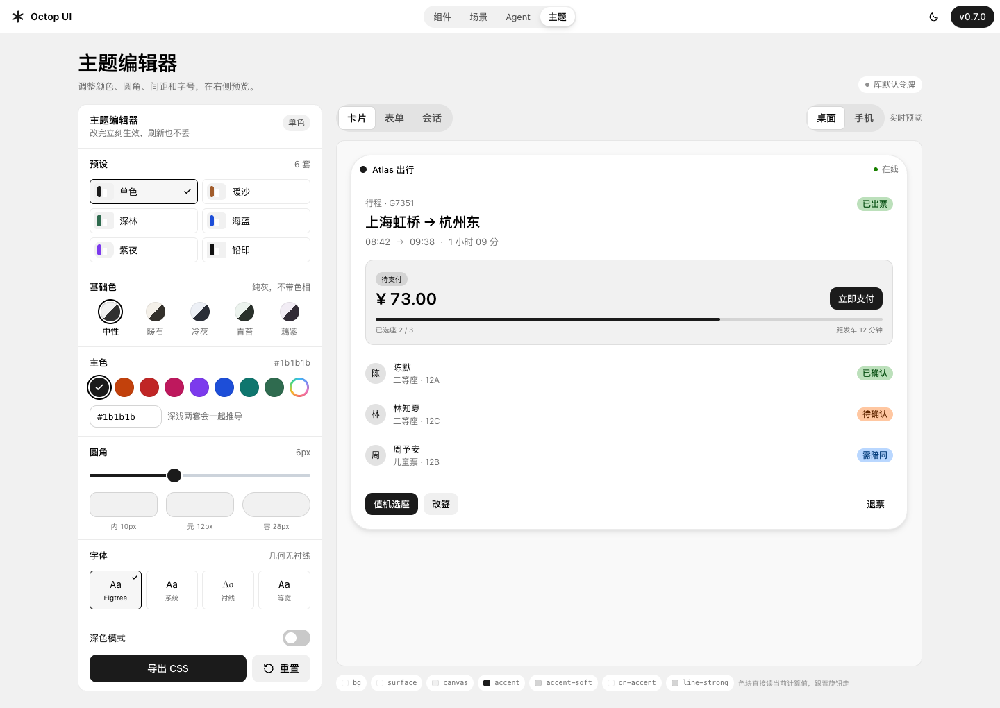

# @octop/ui

采用 shadcn/ui 样式约定的 React 组件库。导入组件和样式即可使用，主题编辑器支持实时预览。

```tsx
import { Button, Select, Modal } from '@octop/ui';
import '@octop/ui/style.css';

<Button type="primary" icon={<Plus />}>新增</Button>
<Select options={[{ label: '杭州', value: 'hz' }]} onChange={(v, option) => {}} />
<Modal open={open} title="编辑" onOk={save} onCancel={close}>…</Modal>
```

- **API 形态**：数据驱动的 `items`（Tabs / Collapse / Menu / Steps / Descriptions）、`destroyOnHidden`、`Divider titlePlacement`、`Button iconPosition`、`Modal.xxx` 命令式 API
- **React**：`^18.2 || ^19`，声明为 peer dependency，不打包进产物

**在线展厅**：<https://liukewia.github.io/octop-ui/>（`?theme=dark` 直接进深色）


> 展厅（`npm run dev`）顶栏分 **组件 / 场景 / Agent / 主题** 四个视图：组件视图按 基础 / 布局 / 录入 / 展示 / 反馈 / 导航 / 高级 七组把 68 个组件铺开；场景视图拼出 6 个业务页面；Agent 视图再补 6 屏「过程可见」的界面；主题视图是可热更的令牌编辑器。四个视图都验过浅色 / 深色 / 390px 窄屏。
> 每次 push 到 `main`，`.github/workflows/pages.yml` 会构建并发布到 GitHub Pages。

场景视图用 `?view=scenes&scene=<id>` 定位，可以直接把某一块发给同事（主题视图是 `?view=theme`）：

| 场景 | 看点 | 主要组件 |
| --- | --- | --- |
| `dashboard` 增长看板 | 指标卡与表格的密度、数字对齐 | Statistic / Segmented / Progress / Table |
| `inbox` 消息中心 | 左列表右详情、未读态与空状态 | Input / Segmented / Badge / Avatar / Empty |
| `settings` 账号设置 | Tab 分栏、开关清单、危险操作确认 | Tabs / Select / Switch / Modal / Alert |
| `checkout` 下单结算 | 步骤、数量增减、优惠抵扣、二次确认 | Steps / RadioGroup / InputNumber / Result |
| `assistant` AI 助手 | 气泡、引用上标、来源列表、代码块 | ChatMessage / ChatComposer / Citation / CodeBlock |
| `mobile` 移动端 | 390 宽下的触控尺寸与底部抽屉 | BottomSheet / CheckableTag / InputNumber |

这些页面全部写在 `demo/scenes/` 里，只消费 `src/` 的导出，库本身没有为它们加过一个类名。


Agent 视图用 `?view=agent&agent=<id>` 定位。它解决的不是「怎么聊天」，而是「怎么让不确定的过程看得见」：

| 场景 | 看点 | 主要组件 |
| --- | --- | --- |
| `chat` 对话模板 | 一条完整的排查对话：思考流式写入、工具调用、带引用的回答、需要确认的下一步 | AgentBubble / AgentSender / AgentReasoning / AgentTool / AgentSources / AgentConfirmation |
| `trace` 运行轨迹 | 规划 / 检索 / 工具 / 重试 / 审批逐步展开，带耗时与 token | StatusDot / Tabs / CodeBlock / Alert |
| `approval` 工具审批 | 计划、影响面、回滚脚本摆在一张卡上，二次确认才执行 | Drawer / Descriptions / Collapse / Checkbox |
| `team` 多 Agent | 主控与三个子 Agent 的分工、预算、交接记录 | Progress / Avatar / Popconfirm / Segmented |
| `builder` 编排配置 | 提示 / 工具 / 知识库 / 预算，右侧实时算代价 | Input / TextArea / Select / Slider / Switch |
| `evals` 评测对比 | v3 与 v4 逐条 diff，回归用例单独标红 | Table 展开行 / Statistic / CodeBlock |

这六屏同样只消费 `src/` 的导出；为了让「暂停 / 继续 / 审批 / 终止」都有真实反馈，交互状态全部写在场景组件内部，库代码没有为 demo 增加过 props。


---

## 快速开始

```bash
npm i @octop/ui            # 或指向 git tag，见下一节
npm i react-hook-form      # 表单要用；必须和库共用同一份实例，故列为 peer
npm i zod @hookform/resolvers   # 用 zod 做校验时
```

```tsx
// 1) 引一次 CSS（构建期已编译好，消费方不需要 Tailwind）
import '@octop/ui/style.css';

// 2) 需要深色模式时，在根节点切一次
import { ConfigProvider } from '@octop/ui';

<ConfigProvider theme={{ mode: 'dark' }} global>
  <App />
</ConfigProvider>;
```

`global` 会把 `.dark` 与令牌写到 `<html>`，这样 Modal / Drawer 这类挂到 `body` 的浮层也能拿到主题。

### 本地开发

```bash
npm run dev          # 展厅 demo（就是本仓库的验收页）
npm run typecheck    # tsc --noEmit
npm run build        # 类型声明 + 库产物到 dist/
npm run demo:build   # 静态化展厅，输出 demo-dist/
npm run demo:preview # 本地预览 demo-dist/
```

展厅的构建用相对 `base`（`base: './'`），所以同一个 `demo-dist/` 既能本地 `preview`，
也能直接丢进任意子路径的静态托管（GitHub Pages 的 project site 就在 `/octop-ui/` 下）。

---

## 三种分发方式，以及什么时候换

跨仓库共享 UI 库有三条路。**默认走 Git tag**：不用发 npm，版本即 tag，锁 lockfile 即锁代码。

### 1) Git tag / commit SHA（当前选择）

```jsonc
// 业务仓库 package.json
{
  "dependencies": {
    "@octop/ui": "github:your-org/octop-ui#v0.1.0"
    // 追具体提交（不推荐长期用，但排查问题很方便）
    // "@octop/ui": "github:your-org/octop-ui#a1b2c3d"
  }
}
```

```bash
npm i && git add package-lock.json && git commit -m "chore: bump @octop/ui to v0.1.0"
```

- 包管理器从 Git 取包后会执行本仓库的 `prepare`（即 `npm run build`），
  在消费方机器上现场构建出 `dist/`。所以**不需要往 Git 里提交产物**，`dist/` 一直在 `.gitignore` 里。
- 这条路的隐形成本：消费方的 `npm i` 会跑一次 TS + Vite 构建（约 3s），并且要能装上本仓库的 devDependencies。
  如果 CI 环境不允许（比如离线镜像），换第 2 种方式。
- 私有仓库要给业务 CI 配 Git 读权限（deploy key 或 machine user），否则 `npm i` 会卡在鉴权。
- 升级 = 改 tag → 重装 → 提交 lockfile。回滚 = 把 tag 改回去。

**什么时候用它**：仓库数量少（1–5 个）、迭代节奏跟业务同步、希望"改一行 UI 立刻在所有仓库生效"。

### 2) `npm pack` 出的 `.tgz`（构建一次，到处安装）

```bash
npm run pack:tgz          # → octop-ui-0.1.0.tgz
```

```jsonc
{ "dependencies": { "@octop/ui": "file:../vendor/octop-ui-0.1.0.tgz" } }
```

- 产物是**已经构建好的 dist**，消费方不需要跑本仓库的构建链，也没有 Git 权限问题。
- `.tgz` 要跟着版本走：可以放进私有 registry（Verdaccio / GitHub Packages）、对象存储，或者直接提交到 `vendor/` 目录。
- `import { Button } from '@octop/ui'` 一行都不用改。

**什么时候换**：仓库变多、CI 环境不允许访问 Git、或者你希望"升级是一个显式的、可审计的动作"而不是跟着 tag 漂移。

### 3) shadcn Registry（各仓库持有源码）

```bash
npx shadcn@latest add https://your-host/r/button.json
```

- 组件源码被复制进业务仓库，之后由业务仓库自己改、自己合并升级（diff 冲突自己解）。
- 适合"设计语言只是起点，每个业务都要魔改"的团队。
- 代价：主题、动效、焦点这些**跨组件约定**会被复制成 N 份，改一处要改 N 个仓库。

**什么时候换**：设计要按业务线分叉，或者团队不接受"UI 库是黑盒"。

### 判据一句话

> 想让所有仓库**共享同一份实现** → Git tag；
> 想让构建**只发生一次**、且升级可控可审计 → `.tgz`；
> 想让各仓库**拥有源码**、允许分叉 → Registry。

---

## 组件约定

```diff
- import { Button, Select, Modal, message } from 'your-legacy-ui';
- import 'your-legacy-ui/reset.css';
+ import { Button, Select, Modal, message } from '@octop/ui';
+ import '@octop/ui/style.css';
```

换 import 就到位了。下面四条约定需要过一遍：

### 1. 回调参数带上上下文

```tsx
// Select：第二个参数是 option
onChange={(value, option) => {}}

// Table：三个参数
onChange={(pagination, filters, sorter) => {}}

// DatePicker：dayjs + 字符串
onChange={(date, dateString) => {}}

// Checkbox：事件对象里有 target.checked
onChange={(e) => e.target.checked}

// Radio.Group：事件对象里有 target.value
onChange={(e) => e.target.value}

// Input.Search：值、事件、来源
onSearch={(value, event, { source }) => {}}
```

### 2. 受控状态

所有受控组件都走同一个 `useControllableState`：传 `value` 就是受控（内部不落状态），
传 `defaultValue` 就是非受控，两者都传时受控优先、`defaultValue` 只作首帧兜底。

```tsx
<Select value={v} onChange={setV} />          // 受控
<Select defaultValue="hz" />                  // 非受控
```

### 3. 焦点恢复

- 弹层（Modal / Drawer / Popover / Select / Dropdown）关闭后焦点回到触发元素。
- 文本类控件聚焦是「描边转墨色 + 内侧 2px 8% 暗层」，**没有外环**；
  其余控件是「2px 外环 + 3px 偏移」。两套语言，全局统一。
- Tab 键顺序按 DOM 顺序；Select 是 combobox 语义（↑↓ / Home / End / Enter / Esc / Backspace 删 tag）。

### 4. TypeScript

类型基本都是手写的（只有表单的字段类型借 `react-hook-form` / `zod` 推断）。常用的都直接导出：

```tsx
import type {
  ColumnType, TableProps, SortOrder, Key,
  SelectOption, SelectProps,
  FormFieldProps, FormItemProps, FormLabelProps, UseFormFieldReturn,
  TabItem, MenuItemType, StepItem, TreeNodeData,
  UploadFile, TransferItem, CascaderOption,
} from '@octop/ui';
```

`Table` 的泛型是 `<T extends object>`，`columns` 与 `dataSource` 会一起推断，不用手写 `<Table<Order>>`。

---

## API 一览

### 组件与主要 Props

Button（type/size/shape/block/danger/ghost/loading/icon/iconPosition/htmlType/href）、
Space（含 `Space.Compact`）、Flex、Typography（Text/Paragraph/Title/Link）、Divider（`orientation` 与 `titlePlacement` 都收）、
Input（含 `TextArea`/`Password`/`Search`/`OTP`）、InputNumber、Select（options/mode/labelInValue/showSearch/filterOption/tokenSeparators/maxTagCount）、
Cascader、TreeSelect、DatePicker（含 `DatePicker.RangePicker`、`DatePicker.TimePicker`）、Checkbox/CheckboxGroup、Radio/RadioGroup、
Switch、Slider、Rate、Segmented、Form/FormField/FormItem/FormLabel/FormControl/FormDescription/FormMessage、
Upload、Transfer、Mentions、Table（sorter/filters/rowSelection/expandable/scroll/sticky/pagination）、
Tag/CheckableTag/Badge、Avatar/Avatar.Group、List/List.Item.Meta、Descriptions、Collapse、Timeline、Tree、
Statistic/Statistic.Countdown、Tooltip/Popover、Empty、Skeleton、Image、Carousel、Calendar、Watermark、
Alert、message/notification（命令式 + `useMessage`）、Modal/`Modal.confirm|info|success|warning|error`、
Drawer/DrawerFooter（含 `push` 多级嵌套）、Popconfirm、Progress、Spin、Result、Tour、
Menu/Dropdown、Tabs、Breadcrumb、Steps、Pagination、Anchor、FloatButton（含 `.Group`/`.BackTop`）、
Layout（Header/Sider/Content/Footer）、Row/Col/Grid、Splitter、Card/Card.Meta、ConfigProvider、

**高级**：CommandPalette、BottomSheet、ChatMessage/ChatComposer/ChatSystemMessage、
Citation/CitationList、CodeBlock、OverflowList、SelectionToolbar、HoverCard、StatusDot、Kbd。

**Agent 模板**：AgentBubble / AgentActions / AgentSender / AgentPrompts / AgentWelcome /
AgentThoughtChain / AgentReasoning / AgentTool / AgentSources / AgentInlineCitation /
AgentConfirmation / AgentPlan / AgentContext / AgentModelSelector / AgentChat /
AgentStreamingResponse / AgentWebSearch / AgentWebSearchAnswer / AgentWebSearchCitation。

**工具类**：`scroll-fade`（含 `-x/-y/-t/-b/-l/-r/-s/-e`、尺寸档、`-none`）、
`shimmer`（含 `-once/-reverse/-none`、`duration/spread/angle` 档）。

### 还没做（按需再补）

- 虚拟滚动（Table / Tree / Select）：业务侧一页 ≤50 行，测量成本高于收益。
- 国际化文案包：组件内文案（"暂无数据""确 定/取消"）目前是中文常量，未接 locale。
- 服务端渲染的水合细节：demo 是纯 CSR；SSR 场景需要确认 `window` 访问（当前都做了 `typeof document` 保护）。

---

## 表单

表单不再自带 store。`<Form>` 就是 `react-hook-form` 的 `FormProvider`，校验交给 zod schema，
组件根据字段状态显示错误提示和相应的 ARIA 属性。

```tsx
const schema = z.object({
  title: z.string().min(5, '标题至少 5 个字。').max(32, '标题最多 32 个字。'),
  description: z.string().min(20, '描述至少 20 个字。'),
});

export function BugReportForm() {
  const form = useForm<z.infer<typeof schema>>({
    resolver: zodResolver(schema),
    defaultValues: { title: '', description: '' },
    mode: 'onTouched',
  });

  return (
    <Form {...form}>
      <form onSubmit={form.handleSubmit((v) => console.log(v))} className="flex flex-col gap-4">
        <FormField
          control={form.control}
          name="title"
          render={({ field }) => (
            <FormItem>
              <FormLabel required>标题</FormLabel>
              <FormControl>
                <Input placeholder="比如：抽屉关闭后焦点没回到触发按钮" {...field} />
              </FormControl>
              <FormMessage />
              <FormDescription>一句话说清在哪儿、做了什么、发生了什么。</FormDescription>
            </FormItem>
          )}
        />
        <Button type="primary" htmlType="submit">提交</Button>
      </form>
    </Form>
  );
}
```

| 部件 | 职责 |
| --- | --- |
| `Form` | `FormProvider`，把 `form` 实例放进 context |
| `FormField` | 包一层 `Controller`，把 `name` 塞进 context，下游自己取错误 |
| `FormItem` | 排版（`layout="vertical" \| "horizontal"`）+ 生成 `id`，并按 `data-invalid` / `data-has-message` 打标 |
| `FormLabel` | `<label htmlFor>` 指向控件的真实 id，必填只画星号（是否必填以 schema 为准） |
| `FormControl` | `Slot`：把 `id` / `aria-invalid` / `aria-describedby` 注给唯一子元素 |
| `FormDescription` / `FormMessage` | 说明与错误，`id` 与上面的 aria 一一对应 |
| `useFormField()` | 自定义控件用：拿 `invalid` / `error` / 三个 id |

错误样式只在一处写：`[data-slot='form-item'][data-invalid] .ax-field` 描红，`[data-has-message]` 时把输入框下面两角削平，
于是红色的 `FormMessage` 像贴在控件下沿的一小块——Input / TextArea / Select 都不需要各自再记 `status`。

---

## 动效

浮层使用 shadcn/ui 的 `animate-in` 和 `animate-out`。浮层根据弹出方向移动，缩放以触发点为基准。

| 组件 | 进入 | 退出 |
| --- | --- | --- |
| Popover / Select / Dropdown / DatePicker | 180ms，淡入、位移 4px、轻微缩放 | 110ms，淡出 |
| Tooltip | 120ms，淡入并移动 2px | 90ms，淡出 |
| Dialog / Modal | 240ms，淡入、上移 6px、轻微缩放 | 130ms，淡出 |
| Drawer / BottomSheet | 280ms，沿所在边缘滑入 | 200ms，沿原方向滑出 |

系统启用减少动态效果时，动画和过渡缩短至 1ms。

## 多级抽屉

打开子抽屉时，父抽屉沿同一方向移开。用 `push.distance` 设置移动距离。

```tsx
<Drawer open={open} onClose={close} title="项目详情" width={520} push={{ distance: 180 }}>
  …
  <Drawer open={members} onClose={closeMembers} title="成员" width={380}>
    …
    <Drawer open={perms} onClose={closePerms} title="权限" width={300}>
      …
    </Drawer>
  </Drawer>
</Drawer>
```

- `push` 默认 `{ distance: 180 }`，`false` 关闭；推开用 `inset`（left/right/top/bottom）而不是 `transform`，避免和进出场动画抢同一个属性。
- **每一层都有自己的遮罩**，但第 2 层起按 62% / 46% / 38% 逐级稀释：全量叠上去会把父层面板压成一块死黑，完全不压又读不出「又深了一层」。传 `mask={false}` 可以关掉某一层。
- 显式设了 `zIndex` 时子层自动接 `+2`、内容 `+3`，不用逐层手算，也不会被子层的遮罩盖住。
- 关掉子层，父层自动归位；`Esc` 只关最上面一层（Radix 的 layer 栈），点父层空白也会关掉子层。
- 嵌套层级压在父层上时，左边描边会升到 `line-strong`，否则两块白面糊成一片。

## 高级组件

`src/components/advanced/` —— 在基础组件之上组合出来的一整块能力。基础组件没有为它们改样式。

| 组件 | 主要 API | 说明 |
| --- | --- | --- |
| CommandPalette | `items` / `groups` / `open` / `hotkey` / `filter` / `onSelect` | ⌘K 命令面板：分组、禁用项、快捷键、键盘走位 |
| BottomSheet | `open` / `height`（`auto\|half\|full` / px）/ `showHandle` / `dragToClose` | 底部抽屉，抓手可下拉关闭（>96px） |
| ChatMessage | `role` / `name` / `avatar` / `status` / `actions` / `loading` | 最小写法的气泡；现在是 `AgentBubble` 的门面，要 header/footer/typing 直接用后者 |
| ChatComposer | `value` / `onChange` / `onSend` / `loading` / `onStop` / `footer` | 自适应高度；Enter 发送、组词期间回车不误发 |
| ChatSystemMessage | `children` / `divider` | 居中系统提示 |
| Citation / CitationList | `index` / `title` / `url`；`items` / `columns` | 正文上标引用 + 来源列表 |
| CodeBlock | `code` / `language` / `title` / `copyable` / `showLineNumbers` / `maxHeight` | 行号与复制，长代码内部滚动 |
| OverflowList | `items` / `renderItem` / `maxCount` / `moreRender` / `onMoreClick` | 真实测量宽度后收进「+N」 |
| SelectionToolbar | `count` / `open` / `onClear` / `children` / `extra` | 批量操作浮条，数量用反相胶囊 |
| HoverCard | `title` / `content` / `openDelay` / `closeDelay` | 悬停卡，鼠标能从触发点移进卡片 |
| StatusDot | `status` / `text` / `pulse` / `size` / `color` | 状态点，`processing` 自带呼吸环 |
| Kbd | `keys` / `separator` / `size` | 键帽：1px 描边 + 底部 2px 读厚度 |

---

## Agent 模板

可从 `@octop/ui` 导入对话、步骤、来源和确认组件。

| AI Elements | 这里 | 主要 API |
| --- | --- | --- |
| Message / Bubble | `AgentBubble` | `placement`（start/end）、`content`、`header`、`footer`、`avatar`、`loading`、`typing`、`variant`、`shape` |
| Prompt Input | `AgentSender` | `value`、`onChange`、`onSubmit`、`onCancel`、`loading`、`attachments`、`header`、`prefix`、`actions`、`footer`、`submitType` |
| Reasoning | `AgentReasoning` | `content`、`loading`、`duration`、`title`、`open` |
| Tool | `AgentTool` | `name`、`status`、`input`、`output`、`error`、`duration`、`defaultOpen` |
| Trace | `AgentThoughtChain` | `items`（`title` / `description` / `icon` / `status` / `content`）、`collapsible`、`line`、`onExpand` |
| Chain of Thought / Task | 同上 | 一步一行，展开看细节；计划和任务都用同一副骨架 |
| Sources | `AgentSources` | `items`（`title` / `url` / `domain` / `snippet`）、`columns` |
| Inline Citation | `AgentInlineCitation` | `index`、`title`、`snippet`、`url` |
| Confirmation | `AgentConfirmation` | `tool`、`params`、`status`（pending/approved/denied）、`onApprove`、`onDeny`、`danger` |
| Plan | `AgentPlan` | `items`（`status` 含 `skipped`）、`progress`、`strikeDone` |
| Context | `AgentContext` | `used`、`total`、`segments`、`warnAt`、`showLabel` |
| Model Selector | `AgentModelSelector` | `models`、`value`、`onChange`、`efforts`、`effort`、`onEffortChange`、`compact` |
| Suggestion | `AgentPrompts` | `items`（`label` / `description` / `icon`）、`columns`、`vertical`、`onItemClick` |
| — | `AgentWelcome` | `icon`、`title`、`description`、`items` |
| Chat | `AgentChat` | `AgentChat.Header` / `.Body` / `.Footer` |
| Message actions | `AgentActions` | `items`（`label` / `icon` / `danger`）、`variant`、`size`、`fadeIn` |
| Streaming Response | `AgentStreamingResponse` | `text`、`status`（streaming/done/stopped）、`speed`、`ink`、`actions`、`onRetry`、`onFeedback`、`onCopy` |
| Web Search | `AgentWebSearch` / `AgentWebSearchAnswer` / `AgentWebSearchCitation` | `sources`、`status`、`query`、`progress`、`expect`、`linked`、`open`；回答侧 `play`、`speed`、`onComplete` |

步骤状态包括`pending | running | success | error`，同时认 `wait / process / finish` 三个旧名，
所以从 `<Steps status="process">` 迁过来不用改字符串。

```tsx
import {
  AgentActions, AgentBubble, AgentChat, AgentConfirmation, AgentContext,
  AgentInlineCitation, AgentReasoning, AgentSender, AgentSources, AgentTool,
} from '@octop/ui';

<AgentBubble placement="end" content={question} />

<AgentBubble
  placement="start"
  content={<span>卡在图片优化这一步<AgentInlineCitation index={1} title="部署缓存键" url="https://…" />。</span>}
  footer={<AgentActions items={[{ key: 'copy', icon: <Copy className="size-3.5" />, tooltip: '复制' }]} />}
/>

<AgentReasoning loading={thinking} duration={5} content={reasoningText} />
<AgentTool name="ci.pipeline_runs" status="success" input={{ branch: 'main' }} output={logs} />
<AgentSources items={sources} />
<AgentConfirmation tool="db.migrate" params={params} onApprove={run} onDeny={skip} />

<AgentChat className="h-[600px]">
  <AgentChat.Header title="Octop Agent" extra={<AgentContext used={42000} total={200000} showLabel={false} className="w-24" />} />
  <AgentChat.Body>{messages}</AgentChat.Body>
  <AgentChat.Footer>
    <AgentSender value={text} onChange={setText} onSubmit={send} loading={running} onCancel={stop} />
  </AgentChat.Footer>
</AgentChat>
```

四个不显然的处理：

1. **助手那侧不加边框**。用户靠反相实底表态，Agent 靠留白表态 —— 长回答不会被一个圆角框反复切断；
   需要边界时再传 `variant="outlined"`。
2. **步骤的竖线接在图标之间**，不是贯穿整条列表：最后一行没有线，「下面还有」这件事由线本身说，
   不需要再加一层「加载更多」。
3. **`AgentChat.Body` 自己记住用户有没有往上翻**：贴底时新消息自动跟进，用户往上翻就暂停，
   回到底部再恢复。滚动监听只在容器上挂一个 passive listener，内容高度用 ResizeObserver 看。
4. **`ChatMessage` 变成了 `AgentBubble` 的门面**：库里只有一套气泡排版，`role` / `name` / `status`
   这些旧参数照旧可用。

### 流式回答与联网搜索

两块「模型还在说」的界面。前者只管一段还在长的文字，后者把「搜了什么、答案引用谁」摊开：

```tsx
import {
  AgentStreamingResponse, AgentWebSearch, AgentWebSearchAnswer, AgentWebSearchCitation,
} from '@octop/ui';

<AgentStreamingResponse
  text={message.content}          // 随着 token 增长，支持 markdown
  status={done ? 'done' : running ? 'streaming' : 'stopped'}
  ink="var(--ax-accent)"          // 新字先落在这个颜色上，再淡回正文色
  onRetry={retry}
  onFeedback={(r) => rate(r)}     // up / down / null（再点一次取消）
/>

<AgentWebSearch sources={sources} status="searching" query="reduced motion" expect={4} />
<AgentWebSearchAnswer play={!thinking}>
  动效可以关，状态变化不能关
  <AgentWebSearchCitation source={sources[0]} index={1} />
  。
</AgentWebSearchAnswer>
```

**先解析，再揭示。** 流式渲染最大的坑是「对着半截 markdown 跑解析器」：`**` 先露出来再合并。这里的做法是
先把全文解析成 block → token，每个 token 记住自己在原文里的偏移；落字时只按已揭示的字符数裁剪 token，
所以粗体、行内代码、链接在出现的那一刻就已经是样式。

**速度是按「追平后」算的。** `speed` 是最追平之后每秒多少个词（中文按字折算），落后一百多个字符时自动加速，
一次大 token 不会积压成卡顿；标点后停 70–150ms，落字本身按 45–115ms 的随机间隔一阵一阵走 ——
均匀速度读起来像机器。

**光点不是光标。** 它不是「输入位置」，而是「字从这里长出来」：新字从 3.5px 的虚焦里长出，
行尾那枚 5px 的点和落字色同色。行内代码自带底色，虚焦会把色块一起糊开，所以它只淡入、不虚焦。

**搜索先占格，再长结果。** 环形进度套在地球外面，站点图标叠成一小摞、悬停散开，条数写在标签里；
结果是先占格、再一条条长进来，比最后一起蹦出来更像「在搜」。`AgentWebSearchAnswer` 只给正文打字，
`AgentWebSearchCitation` 整块落下 —— 引用是事实，不该有「正在打出来」的中间态。

`AgentThoughtChain` 负责步骤容器，`AgentReasoning` 展示思考过程，`AgentTool` 展示工具调用。

---

## 工具类：scroll-fade / shimmer

两个纯 CSS 的 utility（对应 shadcn 的 `shadcn/tailwind.css`），不挂脚本、不写滚动监听。写在
`src/styles/index.css` 里，跟组件一起进 `octop-ui.css`，消费方不用装 Tailwind。

### scroll-fade

```tsx
<div className="scroll-fade max-h-[232px] overflow-y-auto">{/* ... */}</div>
<div className="scroll-fade-x flex gap-2 overflow-x-auto">{/* ... */}</div>
```

静止时起始边清晰、结束边渐隐；往下滚，起始边渐显、两端同时留雾；到底后结束边收回。
遮罩写在 `mask-image` 上（`mask-composite: intersect` 拼上下两道渐变），淡掉的是内容本身，
换背景不用改色。

| class | 作用 |
| --- | --- |
| `scroll-fade` / `scroll-fade-y` | 纵向两端 |
| `scroll-fade-x` | 横向两端，`dir` 变了自动镜像 |
| `scroll-fade-t` / `-b` | 只淡上 / 下 |
| `scroll-fade-l` / `-r` | 只淡左 / 右（物理边） |
| `scroll-fade-s` / `-e` | 只淡行内起 / 止（RTL 镜像） |
| `scroll-fade-6` / `scroll-fade-[15%]` | 渐隐深度（默认 `min(12%, 40px)`） |
| `scroll-fade-none` | 关掉，任何顺序都生效 |

深度也可以直接给变量：`--scroll-fade-size`（两边）、`--scroll-fade-b-size`（单边）、
`--scroll-fade-reveal`（默认 96px，决定「滚多远渐隐到满」）。内容不溢出就不会淡，可以无脑加。

滚动位置靠 CSS 滚动驱动动画（`animation-timeline: scroll(self y)`）驱动四个自定义属性；
不支持的浏览器退回双边静态渐隐，不报错。

### shimmer

```tsx
<p className="shimmer text-lg text-fg">正在生成回答…</p>
```

一条高光带扫过文字，用来表示「正在进行」。纯 CSS：`background-clip: text` + 移动的渐变，
高光色由 `currentColor` 与白色混合，浅色模式提亮、深色模式自动更亮。

| class | 作用 |
| --- | --- |
| `shimmer` | 默认 2s / 20° / `calc(3ch + 40px)` |
| `shimmer-once` | 只扫一次（配 `key` 重播） |
| `shimmer-reverse` | 反方向 |
| `shimmer-duration-1000` | 一次扫光的毫秒数 |
| `shimmer-spread-8` | 光带宽度（间距刻度） |
| `shimmer-angle-45` | 光带倾角 |
| `shimmer-none` | 关掉，任何顺序都生效 |

高光色可以单独给：`style={{ '--shimmer-color': 'var(--ax-accent)' }}`。
`prefers-reduced-motion: reduce` 下自动停扫、文字回到自己的颜色。

预编译产物里已经带了 `scroll-fade-{4,6,8,12,16,24}`、`shimmer-duration-{800,1000,1200}`、
`shimmer-spread-{4,8,16,24}`、`shimmer-angle-{0,45,90}` 这几档；其余档位在自己的 Tailwind 里能直接用，
或给对应 CSS 变量。

---

## 主题：五个旋钮，推出一整套令牌

`src/components/theme/` —— 一个可视化主题编辑器，加上它背后的推导函数。左边五个旋钮
（基础色 / 主色 / 圆角 / 字体 / 密度），右边是真实组件拼出来的预览；改完立刻生效，
刷新还在，导出的 CSS 可以直接贴进别的项目。



```tsx
import {
  DEFAULT_THEME, ThemeEditor, applyTheme, readStoredTheme, storeTheme, themeToCss,
} from '@octop/ui';
import type { ThemeConfig } from '@octop/ui';

const [theme, setTheme] = useState<ThemeConfig | null>(() => readStoredTheme());

// 用 layout effect：先写 <style> 再出首帧，刷新不会闪一下默认皮肤
useLayoutEffect(() => {
  applyTheme(theme); // 传 null 就恢复库默认
  storeTheme(theme);
}, [theme]);

<ThemeEditor
  value={theme ?? DEFAULT_THEME}
  onChange={setTheme}
  onReset={() => setTheme(null)}
  mode={mode}
  onModeChange={setMode}
/>;
```

| 导出 | 用途 | 主要参数 |
| --- | --- | --- |
| `ThemeEditor` | 控制面板（不含预览，预览由调用方拼） | `value` / `onChange` / `onReset` / `mode` / `onModeChange` / `presets` |
| `deriveTheme` | 只算令牌，不落盘 | `config` → `{ light, dark }` |
| `themeToCss` | 生成可粘贴的 CSS | `config` → `string` |
| `applyTheme` | 运行时热更；`null` 还原 | `config \| null` |
| `readStoredTheme` / `storeTheme` | 本地持久化（带校验） | — |
| `THEME_PRESETS` / `DEFAULT_THEME` / `THEME_BASES` / `THEME_ACCENTS` / `THEME_FONTS` | 预设与候选值 | — |

四个取舍：

**推导在 JS，产物是 CSS。** 旋钮算出来的是一张 `--ax-*` 表，`applyTheme` 把它写成 `<style>`
里的 `html:root` 与 `html.dark`。选择器比库里的 `:root` / `.dark` 多一层类型选择器，
无论这段样式插在哪个位置都盖得住默认值，又不会把深色一起盖掉 —— 热更不闪、不与原样式打架，
靠的就是这一层。

**只覆盖该覆盖的。** 面、字、线、accent、圆角、控件高度、字体进主题；`danger` / `success` /
`warning` / `info` 与十色板留在库里。状态色的可读性是底线，不该被「换个主色」顺带带走。

**主色不只一个值。** hover 由主色混白 / 混黑推出（浅色下暗主色提亮、亮主色压深），
`accent-soft` 用 `color-mix(in oklab, var(--ax-accent) 12%, var(--ax-surface))` 跟表面走，
`on-accent` 按 WCAG 相对亮度在黑 / 白之间选。深色模式下近黑的主色会翻成 12% 白的浅色 ——
否则单色主题的按钮会陷进背景里。

**中性色是明度阶，不是五套十六进制。** 五个基底只改 oklch 的 hue / chroma：画布 96.6%、
次级字 38 / 50 / 64.5，深色 22 / 26 / 17。所以「暖石」「青苔」改的是色相，不是对比度。

展厅里这套就是主题视图（`?view=theme`）：改完切回组件视图，整站已经换了皮肤；
文档里写死的 `radius 6 / 10 / 12 / 28` 也跟着令牌走（`applyTheme` 会广播一次 `octop:theme`）。

---

## 设计基座

四层结构，从下往上：

1. **令牌**：`:root` / `.dark` 上的 `--ax-*`（面、字、线、accent、语义色、十色板、圆角、高度、时钟、影）。
2. **映射**：`@theme inline` 把令牌变成 Tailwind 语义类（`bg-surface` / `text-fg-secondary` / `rounded-element` / `ease-standard`）。
3. **修正**：`@layer components` 里的 `.ax-*`（两套焦点、按压叠色、字段壳、浮层、遮罩、spinner、骨架）。
4. **动效**：utilities 层的 `animate-in/out` 组合（见上节），常量集中在 `src/lib/motion.ts`。
5. **组件**：只写语义类，不出现十六进制、不出现 `ms` 字面量。

### 高度与可点区

```css
:root { --ax-h-sm: 32px; --ax-h-md: 40px; --ax-h-lg: 48px; }

@media (pointer: coarse) {
  :root { --ax-h-sm: 36px; --ax-h-md: 44px; --ax-h-lg: 52px; }
}
```

一个媒体查询把整套控件的可点区抬到 44+，组件代码一行不改。

---

## 目录

```
src/
  index.ts               全量导出（按 基础 / 布局 / 录入 / 展示 / 反馈 / 导航 分组）
  styles/index.css       唯一的 CSS 源：令牌 + @theme + 组件层 + 两枚自造 keyframe
  lib/
    cn.ts                clsx + tailwind-merge、omitUndefined、statusToInvalid
    hooks.ts             useControllableState / useMeasure / useMediaQuery / useRestoreFocus
    field.ts             控件壳（height/text/pad/variant → fieldShell）
    motion.ts            浮层的进出场类名：popup / tooltip / dialog / sheet / drawer
  components/            55 个基础组件文件
    advanced/            13 个高级导出（命令面板、底部抽屉、会话、引用、代码块…）
    agent/               19 个 Agent 模板导出（气泡 / 步骤 / 来源 / 流式 / 联网搜索…）
    theme/               主题引擎：令牌推导 + 可视化编辑器
demo/
  App.tsx                展厅外壳（顶栏 / 侧栏 / hero）
  theme-studio.tsx       主题视图（面板 + 三种预览）
  sections/*.tsx         按分类的展示页
  primitives.tsx         Section / Demo / Row / Stack / Hint
```

## 验收

- `npm run typecheck`：0 error
- `npm run build`：类型声明 + 库产物，无外部依赖被打包（全部 external）
- `npm run demo:build` + `demo:preview`：展厅可静态化，浅色 / 深色 / 390px 窄屏三套都在盯
- GitHub Pages：<https://liukewia.github.io/octop-ui/> — push `main` 自动构建发布，线上浅色 / 深色均已核对
- 主题：五套预设 × 浅色 / 深色逐一截图；改主色、圆角、密度、字体后刷新仍在，`重置` 能清掉 `<style>` 与 localStorage

## License

MIT
