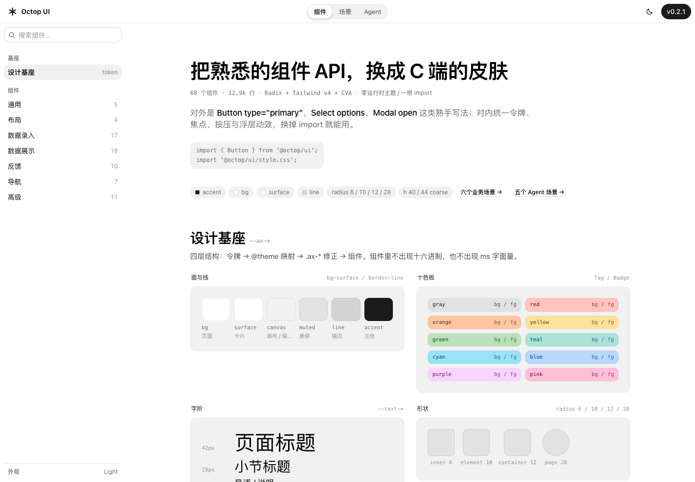
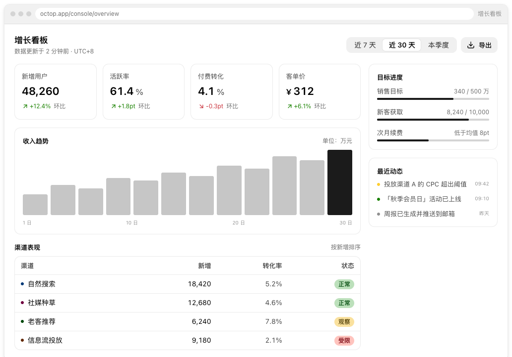
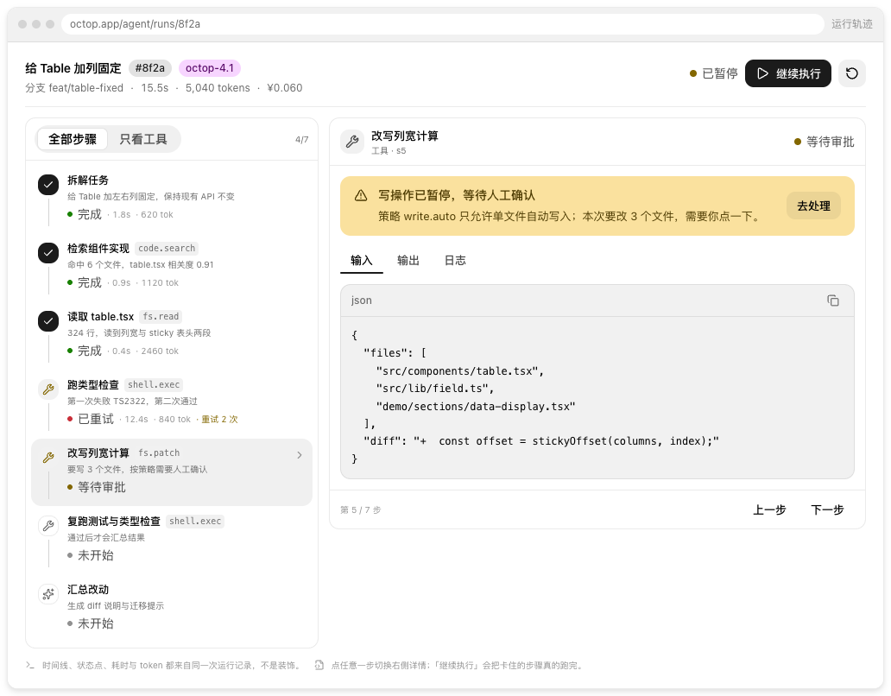

# @octop/ui

一套面向 **C 端** 的 React 组件库：底层是 shadcn/ui 的做法（Radix Primitives + Tailwind v4 + CVA），
皮肤是 Astryx 的十色板与四层令牌。68 个组件（55 个基础 + 13 个高级）共用同一套高度、焦点、按压与浮层时钟，引一次 CSS 就能跑起来。

```tsx
import { Button, Select, Modal } from '@octop/ui';
import '@octop/ui/style.css';

<Button type="primary" icon={<Plus />}>新增</Button>
<Select options={[{ label: '杭州', value: 'hz' }]} onChange={(v, option) => {}} />
<Modal open={open} title="编辑" onOk={save} onCancel={close}>…</Modal>
```

- **API 形态**：数据驱动的 `items`（Tabs / Collapse / Menu / Steps / Descriptions）、`destroyOnHidden`、`Divider titlePlacement`、`Button iconPosition`、`Modal.xxx` 命令式 API
- **组件**：65 个文件、68 个导出（55 基础 + 13 高级）、约 12.9k 行实现，零运行时主题
- **产物**：`dist/index.js`（~284KB / gzip 67KB）、`dist/octop-ui.css`（~72KB / gzip 13KB）、完整 `.d.ts`
- **动效**：shadcn 的 `animate-in` / `animate-out` 组合类（`tw-animate-css`），时长与曲线仍走 Astryx 令牌
- **React**：`^18.2 || ^19`，声明为 peer dependency，不打包进产物

**在线展厅**：<https://liukewia.github.io/octop-ui/>（`?theme=dark` 直接进深色）



> 展厅（`npm run dev`）顶栏分 **组件 / 场景 / Agent** 三个视图：组件视图按 基础 / 布局 / 录入 / 展示 / 反馈 / 导航 / 高级 七组把 68 个组件铺开；场景视图拼出 6 个业务页面；Agent 视图再补 5 屏「过程可见」的界面。三个视图都验过浅色 / 深色 / 390px 窄屏。
> 每次 push 到 `main`，`.github/workflows/pages.yml` 会构建并发布到 GitHub Pages。

场景视图用 `?view=scenes&scene=<id>` 定位，可以直接把某一块发给同事：

| 场景 | 看点 | 主要组件 |
| --- | --- | --- |
| `dashboard` 增长看板 | 指标卡与表格的密度、数字对齐 | Statistic / Segmented / Progress / Table |
| `inbox` 消息中心 | 左列表右详情、未读态与空状态 | Input / Segmented / Badge / Avatar / Empty |
| `settings` 账号设置 | Tab 分栏、开关清单、危险操作确认 | Tabs / Select / Switch / Modal / Alert |
| `checkout` 下单结算 | 步骤、数量增减、优惠抵扣、二次确认 | Steps / RadioGroup / InputNumber / Result |
| `assistant` AI 助手 | 气泡、引用上标、来源列表、代码块 | ChatMessage / ChatComposer / Citation / CodeBlock |
| `mobile` 移动端 | 390 宽下的触控尺寸与底部抽屉 | BottomSheet / CheckableTag / InputNumber |

这些页面全部写在 `demo/scenes/` 里，只消费 `src/` 的导出，库本身没有为它们加过一个类名。



Agent 视图用 `?view=agent&agent=<id>` 定位。它解决的不是「怎么聊天」，而是「怎么让不确定的过程看得见」：

| 场景 | 看点 | 主要组件 |
| --- | --- | --- |
| `trace` 运行轨迹 | 规划 / 检索 / 工具 / 重试 / 审批逐步展开，带耗时与 token | StatusDot / Tabs / CodeBlock / Alert |
| `approval` 工具审批 | 计划、影响面、回滚脚本摆在一张卡上，二次确认才执行 | Drawer / Descriptions / Collapse / Checkbox |
| `team` 多 Agent | 主控与三个子 Agent 的分工、预算、交接记录 | Progress / Avatar / Popconfirm / Segmented |
| `builder` 编排配置 | 提示 / 工具 / 知识库 / 预算，右侧实时算代价 | Input / TextArea / Select / Slider / Switch |
| `evals` 评测对比 | v3 与 v4 逐条 diff，回归用例单独标红 | Table 展开行 / Statistic / CodeBlock |

这五屏同样只消费 `src/` 的导出；为了让「暂停 / 继续 / 审批 / 终止」都有真实反馈，交互状态全部写在场景组件内部，库代码没有为 demo 增加过 props。



---

## 为什么不用现成的组件库

| | 运行时样式型组件库 | 本仓库 |
| --- | --- | --- |
| 主题 | 靠 Provider 覆盖 token，改不到结构 | 令牌 + `@layer` 组合，结构本身就是设计 |
| 包体 | 全量 cssinjs 运行时 | 预编译 CSS，没有运行时样式计算 |
| 交互 | 库自带的动效时钟与形态，想改要绕开它 | 我们自己的时钟（95→525ms 七档）与形态 |
| 依赖 | 组件库本体 + 一长串 rc-* 依赖 | Radix 一组 + cva/clsx/tailwind-merge |

代价是要维护 68 个组件；换来的是「视觉与交互完全可控」和「消费方不用装 Tailwind」。

---

## 快速开始

```bash
npm i @octop/ui            # 或指向 git tag，见下一节
```

```tsx
// 1) 引一次 CSS（构建期已编译好，消费方不需要 Tailwind）
import '@octop/ui/style.css';

// 2) 需要深色模式时，在根节点切一次
import { ConfigProvider } from '@octop/ui';

<ConfigProvider theme={{ mode: 'dark' }} global>
  <App />
</ConfigProvider>;
```

`global` 会把 `.dark` 与令牌写到 `<html>`，这样 Modal / Drawer 这类挂到 `body` 的浮层也能拿到主题。

### 本地开发

```bash
npm run dev          # 展厅 demo（就是本仓库的验收页）
npm run typecheck    # tsc --noEmit
npm run build        # 类型声明 + 库产物到 dist/
npm run demo:build   # 静态化展厅，输出 demo-dist/
npm run demo:preview # 本地预览 demo-dist/
```

展厅的构建用相对 `base`（`base: './'`），所以同一个 `demo-dist/` 既能本地 `preview`，
也能直接丢进任意子路径的静态托管（GitHub Pages 的 project site 就在 `/octop-ui/` 下）。

---

## 三种分发方式，以及什么时候换

跨仓库共享 UI 库有三条路。**默认走 Git tag**：不用发 npm，版本即 tag，锁 lockfile 即锁代码。

### 1) Git tag / commit SHA（当前选择）

```jsonc
// 业务仓库 package.json
{
  "dependencies": {
    "@octop/ui": "github:your-org/octop-ui#v0.1.0"
    // 追具体提交（不推荐长期用，但排查问题很方便）
    // "@octop/ui": "github:your-org/octop-ui#a1b2c3d"
  }
}
```

```bash
npm i && git add package-lock.json && git commit -m "chore: bump @octop/ui to v0.1.0"
```

- 包管理器从 Git 取包后会执行本仓库的 `prepare`（即 `npm run build`），
  在消费方机器上现场构建出 `dist/`。所以**不需要往 Git 里提交产物**，`dist/` 一直在 `.gitignore` 里。
- 这条路的隐形成本：消费方的 `npm i` 会跑一次 TS + Vite 构建（约 3s），并且要能装上本仓库的 devDependencies。
  如果 CI 环境不允许（比如离线镜像），换第 2 种方式。
- 私有仓库要给业务 CI 配 Git 读权限（deploy key 或 machine user），否则 `npm i` 会卡在鉴权。
- 升级 = 改 tag → 重装 → 提交 lockfile。回滚 = 把 tag 改回去。

**什么时候用它**：仓库数量少（1–5 个）、迭代节奏跟业务同步、希望"改一行 UI 立刻在所有仓库生效"。

### 2) `npm pack` 出的 `.tgz`（构建一次，到处安装）

```bash
npm run pack:tgz          # → octop-ui-0.1.0.tgz
```

```jsonc
{ "dependencies": { "@octop/ui": "file:../vendor/octop-ui-0.1.0.tgz" } }
```

- 产物是**已经构建好的 dist**，消费方不需要跑本仓库的构建链，也没有 Git 权限问题。
- `.tgz` 要跟着版本走：可以放进私有 registry（Verdaccio / GitHub Packages）、对象存储，或者直接提交到 `vendor/` 目录。
- `import { Button } from '@octop/ui'` 一行都不用改。

**什么时候换**：仓库变多、CI 环境不允许访问 Git、或者你希望"升级是一个显式的、可审计的动作"而不是跟着 tag 漂移。

### 3) shadcn Registry（各仓库持有源码）

```bash
npx shadcn@latest add https://your-host/r/button.json
```

- 组件源码被复制进业务仓库，之后由业务仓库自己改、自己合并升级（diff 冲突自己解）。
- 适合"设计语言只是起点，每个业务都要魔改"的团队。
- 代价：主题、动效、焦点这些**跨组件约定**会被复制成 N 份，改一处要改 N 个仓库。

**什么时候换**：设计要按业务线分叉，或者团队不接受"UI 库是黑盒"。

### 判据一句话

> 想让所有仓库**共享同一份实现** → Git tag；
> 想让构建**只发生一次**、且升级可控可审计 → `.tgz`；
> 想让各仓库**拥有源码**、允许分叉 → Registry。

---

## 组件约定

```diff
- import { Button, Select, Modal, message } from 'your-legacy-ui';
- import 'your-legacy-ui/reset.css';
+ import { Button, Select, Modal, message } from '@octop/ui';
+ import '@octop/ui/style.css';
```

换 import 就到位了。下面四条约定需要过一遍：

### 1. 回调参数带上上下文

```tsx
// Select：第二个参数是 option
onChange={(value, option) => {}}

// Table：三个参数
onChange={(pagination, filters, sorter) => {}}

// DatePicker：dayjs + 字符串
onChange={(date, dateString) => {}}

// Checkbox：事件对象里有 target.checked
onChange={(e) => e.target.checked}

// Radio.Group：事件对象里有 target.value
onChange={(e) => e.target.value}

// Input.Search：值、事件、来源
onSearch={(value, event, { source }) => {}}
```

### 2. 受控状态

所有受控组件都走同一个 `useControllableState`：传 `value` 就是受控（内部不落状态），
传 `defaultValue` 就是非受控，两者都传时受控优先、`defaultValue` 只作首帧兜底。

```tsx
<Select value={v} onChange={setV} />          // 受控
<Select defaultValue="hz" />                  // 非受控
```

### 3. 焦点恢复

- 弹层（Modal / Drawer / Popover / Select / Dropdown）关闭后焦点回到触发元素。
- 文本类控件聚焦是「描边转墨色 + 内侧 2px 8% 暗层」，**没有外环**；
  其余控件是「2px 外环 + 3px 偏移」。两套语言，全局统一。
- Tab 键顺序按 DOM 顺序；Select 是 combobox 语义（↑↓ / Home / End / Enter / Esc / Backspace 删 tag）。

### 4. TypeScript

类型是手写的，不依赖第三方类型包。常用的都直接导出：

```tsx
import type {
  ColumnType, TableProps, SortOrder, Key,
  SelectOption, SelectProps,
  FormRule, FormInstance, NamePath,
  TabItem, MenuItemType, StepItem, TreeNodeData,
  UploadFile, TransferItem, CascaderOption,
} from '@octop/ui';
```

`Table` 的泛型是 `<T extends object>`，`columns` 与 `dataSource` 会一起推断，不用手写 `<Table<Order>>`。

---

## API 一览

### 组件与主要 Props

Button（type/size/shape/block/danger/ghost/loading/icon/iconPosition/htmlType/href）、
Space（含 `Space.Compact`）、Flex、Typography（Text/Paragraph/Title/Link）、Divider（`orientation` 与 `titlePlacement` 都收）、
Input（含 `TextArea`/`Password`/`Search`/`OTP`）、InputNumber、Select（options/mode/labelInValue/showSearch/filterOption/tokenSeparators/maxTagCount）、
Cascader、TreeSelect、DatePicker（含 `DatePicker.RangePicker`、`DatePicker.TimePicker`）、Checkbox/CheckboxGroup、Radio/RadioGroup、
Switch、Slider、Rate、Segmented、Form/Form.Item/Form.List/Form.useForm/Form.useWatch、
Upload、Transfer、Mentions、Table（sorter/filters/rowSelection/expandable/scroll/sticky/pagination）、
Tag/CheckableTag/Badge、Avatar/Avatar.Group、List/List.Item.Meta、Descriptions、Collapse、Timeline、Tree、
Statistic/Statistic.Countdown、Tooltip/Popover、Empty、Skeleton、Image、Carousel、Calendar、Watermark、
Alert、message/notification（命令式 + `useMessage`）、Modal/`Modal.confirm|info|success|warning|error`、
Drawer/DrawerFooter（含 `push` 多级嵌套）、Popconfirm、Progress、Spin、Result、Tour、
Menu/Dropdown、Tabs、Breadcrumb、Steps、Pagination、Anchor、FloatButton（含 `.Group`/`.BackTop`）、
Layout（Header/Sider/Content/Footer）、Row/Col/Grid、Splitter、Card/Card.Meta、ConfigProvider、

**高级**：CommandPalette、BottomSheet、ChatMessage/ChatComposer/ChatSystemMessage、
Citation/CitationList、CodeBlock、OverflowList、SelectionToolbar、HoverCard、StatusDot、Kbd。

### 与常见做法的选择差异

| 项 | 常见做法 | 这里 | 为什么 |
| --- | --- | --- | --- |
| `Button type="dashed"` | 虚线描边 | **降级为次级填充**（无虚线） | Astryx 没有虚线形态，但参数保留，旧写法不报错 |
| `Tooltip` | 有箭头、深色底 | **无箭头**，反相墨色底（深色模式下自动反相） | 箭头在 12px 圆角上会显得脏 |
| `Segmented` | 指示块瞬间切换 | **225ms 滑动落位**，宽度用 ResizeObserver 量 | 分段是"选择"，位移能表达状态迁移 |
| `Tabs` 墨条 | 200ms 淡入淡出 | **165ms 跟随**（left/width 过渡） | 阅读连续性 |
| `Modal` 窄屏 | 仍是居中对话框 | **≤640px 自动变底部抽屉**（`variant` 可强制） | C 端拇指可达性 |
| 控件高度 | 24/32/40 | **32/40/48**，粗指针设备自动 36/44/52 | C 端可点区 ≥44 |
| 危险按钮 | 红描边 / 红底白字 | **柔红底 + 同族深字** | 降低视觉噪音，仍可识别 |
| `Link` | 品牌蓝 | **文字 + 下划线** | 蓝色在 C 端容易被误认成主按钮 |
| 按压反馈 | 波纹 / 缩放 | **叠 10% 实色**，松开 125ms 淡出 | 没有波纹的"脏边"，也不位移布局 |
| `Divider` 标题位置 | 只收 `orientation` 一个名字 | `orientation` 与 `titlePlacement` 都收 | 两种写法都不必改 |
| `Tabs destroyOnHidden` | 默认卸载未激活面板 | 默认保留 DOM，`forceMount` + `hidden` | 切回来不重挂，滚动位置与表单状态都在 |
| `message` / `notification` | 白卡 + 阴影，图标 14 | **Astryx 原始卡片**：12 圆角、`1px 8%` 描边、`padding 10/16`（通知 `12/24` 宽 380）、正文 14、图标 17、标题 17/400 | 卡片靠描边分层，阴影只做贴地感；小尺寸下不至于糊成一团 |

### 还没做（按需再补）

- 虚拟滚动（Table / Tree / Select）：业务侧一页 ≤50 行，测量成本高于收益。
- 国际化文案包：组件内文案（"暂无数据""确 定/取消"）目前是中文常量，未接 locale。
- 服务端渲染的水合细节：demo 是纯 CSR；SSR 场景需要确认 `window` 访问（当前都做了 `typeof document` 保护）。

---

## 动效：shadcn 的写法，Astryx 的时钟

浮层不再各写一份 `@keyframes`，改成 shadcn 那套「开关类」组合：`animate-in` / `animate-out` 两条通道，
方向、缩放、透明度各是一个独立的类，拼起来才是最终动作。十六处浮层共用 `src/lib/motion.ts` 里的四五个常量。

```tsx
// 浮层：淡入 + scale(.95) + 贴着锚点那一侧推 8px
const POPUP_MOTION = [
  'data-[state=open]:animate-in data-[state=closed]:animate-out',
  'data-[state=open]:fade-in-0 data-[state=closed]:fade-out-0',
  'data-[state=open]:zoom-in-95 data-[state=closed]:zoom-out-95',
  'data-[side=top]:slide-in-from-bottom-2 data-[side=bottom]:slide-in-from-top-2',
  'data-[state=open]:duration-[var(--ax-dur-fast-max)] data-[state=closed]:duration-[var(--ax-dur-fast)]',
  'data-[state=open]:ease-standard data-[state=closed]:ease-exit',
].join(' ');
```

| 浮层 | 入场 | 退场 |
| --- | --- | --- |
| Popover / Select / Dropdown / DatePicker | 165ms：淡入 + `scale(.95)` + 贴锚点 8px | 125ms |
| Tooltip | 125ms：淡入 + 4px | 125ms |
| Dialog / Modal | 400ms：淡入 + `scale(.95)` + 上浮 16px | 125ms：收到 `.98` |
| Drawer | 300ms：整块滑入（不缩放） | 225ms |
| BottomSheet / 窄屏 Modal | 300ms：自底向上 100% | 225ms |
| Toast | 125ms：自上方 8px 落下 | — |

- 方向类用的是 `data-[side=*]`：Select 在上方弹出就从下方推入，不需要 JS 判断 placement。
- 时长走 `duration-[var(--ax-dur-*)]`，所以「95 / 125 / 165 / 225 / 300 / 400 / 525」这套时钟没有变成魔数。
- `tw-animate-css` 只在构建期用（CSS 已经预编译进 `dist/octop-ui.css`），消费方不需要装 Tailwind 或这个包。
- 全局 `prefers-reduced-motion` 仍然生效：动画时长压到 1ms，Radix 会在下一帧卸载浮层。

## 多级抽屉

只借鉴 `Drawer` 的嵌套写法与 `push` 参数，样式按这里的规范来：子层打开时父层沿同一方向让出 `distance`，而不是被盖住。

```tsx
<Drawer open={open} onClose={close} title="项目详情" width={520} push={{ distance: 180 }}>
  …
  <Drawer open={members} onClose={closeMembers} title="成员" width={380}>
    …
    <Drawer open={perms} onClose={closePerms} title="权限" width={300}>
      …
    </Drawer>
  </Drawer>
</Drawer>
```

- `push` 默认 `{ distance: 180 }`，`false` 关闭；推开用 `inset`（left/right/top/bottom）而不是 `transform`，避免和进出场动画抢同一个属性。
- **子层默认不再叠遮罩**：页面已经被最外层的遮罩压暗，第三层再压两次会把前两层抹黑。需要时显式传 `mask`。
- 关掉子层，父层自动归位；`Esc` 只关最上面一层（Radix 的 layer 栈），点父层空白也会关掉子层。
- 嵌套层级压在父层上时，左边描边会升到 `line-strong`，否则两块白面糊成一片。

## 高级组件

`src/components/advanced/` —— 在基础组件之上组合出来的一整块能力。基础组件没有为它们改样式。

| 组件 | 主要 API | 说明 |
| --- | --- | --- |
| CommandPalette | `items` / `groups` / `open` / `hotkey` / `filter` / `onSelect` | ⌘K 命令面板：分组、禁用项、快捷键、键盘走位 |
| BottomSheet | `open` / `height`（`auto\|half\|full` / px）/ `showHandle` / `dragToClose` | 底部抽屉，抓手可下拉关闭（>96px） |
| ChatMessage | `role` / `name` / `avatar` / `status` / `actions` / `loading` | 用户反相气泡、助手留白；操作条悬停才出 |
| ChatComposer | `value` / `onChange` / `onSend` / `loading` / `onStop` / `footer` | 自适应高度；Enter 发送、组词期间回车不误发 |
| ChatSystemMessage | `children` / `divider` | 居中系统提示 |
| Citation / CitationList | `index` / `title` / `url`；`items` / `columns` | 正文上标引用 + 来源列表 |
| CodeBlock | `code` / `language` / `title` / `copyable` / `showLineNumbers` / `maxHeight` | 行号与复制，长代码内部滚动 |
| OverflowList | `items` / `renderItem` / `maxCount` / `moreRender` / `onMoreClick` | 真实测量宽度后收进「+N」 |
| SelectionToolbar | `count` / `open` / `onClear` / `children` / `extra` | 批量操作浮条，数量用反相胶囊 |
| HoverCard | `title` / `content` / `openDelay` / `closeDelay` | 悬停卡，鼠标能从触发点移进卡片 |
| StatusDot | `status` / `text` / `pulse` / `size` / `color` | 状态点，`processing` 自带呼吸环 |
| Kbd | `keys` / `separator` / `size` | 键帽：1px 描边 + 底部 2px 读厚度 |

---

## 设计基座

四层结构，从下往上：

1. **令牌**：`:root` / `.dark` 上的 `--ax-*`（面、字、线、accent、语义色、十色板、圆角、高度、时钟、影）。
2. **映射**：`@theme inline` 把令牌变成 Tailwind 语义类（`bg-surface` / `text-fg-secondary` / `rounded-element` / `ease-standard`）。
3. **修正**：`@layer components` 里的 `.ax-*`（两套焦点、按压叠色、字段壳、浮层、遮罩、spinner、骨架）。
4. **动效**：utilities 层的 `animate-in/out` 组合（见上节），常量集中在 `src/lib/motion.ts`。
5. **组件**：只写语义类，不出现十六进制、不出现 `ms` 字面量。

### 时钟

```
95     hover 微调
125    按压恢复 / 遮罩 / 图标旋转
165    浮层入场（+8px, scale .95）
225    分段滑块 / loading 延迟 / 卡片展开
300    抽屉 / 折叠面板
400    弹窗（+16px, scale .95）/ 骨架呼吸
525    spinner 一圈（135° 弧）
```

曲线只有两条：`standard = cubic-bezier(.24,1,.4,1)`、`exit = cubic-bezier(.3,0,.6,.6)`。

### 高度与可点区

```css
:root { --ax-h-sm: 32px; --ax-h-md: 40px; --ax-h-lg: 48px; }

@media (pointer: coarse) {
  :root { --ax-h-sm: 36px; --ax-h-md: 44px; --ax-h-lg: 52px; }
}
```

一个媒体查询把整套控件的可点区抬到 44+，组件代码一行不改。

---

## 目录

```
src/
  index.ts               全量导出（按 基础 / 布局 / 录入 / 展示 / 反馈 / 导航 分组）
  styles/index.css       唯一的 CSS 源：令牌 + @theme + 组件层 + 两枚自造 keyframe
  lib/
    cn.ts                clsx + tailwind-merge、omitUndefined、statusToInvalid
    hooks.ts             useControllableState / useMeasure / useMediaQuery / useRestoreFocus
    field.ts             控件壳（height/text/pad/variant → fieldShell）
    motion.ts            浮层的进出场类名：popup / tooltip / dialog / sheet / drawer
  components/            55 个基础组件文件
    advanced/            13 个高级导出（命令面板、底部抽屉、会话、引用、代码块…）
demo/
  App.tsx                展厅外壳（顶栏 / 侧栏 / hero）
  sections/*.tsx         按分类的展示页
  primitives.tsx         Section / Demo / Row / Stack / Hint
```

## 验收

- `npm run typecheck`：0 error
- `npm run build`：类型声明 + 库产物，无外部依赖被打包（全部 external）
- `npm run demo:build` + `demo:preview`：展厅可静态化，浅色 / 深色 / 390px 窄屏三套都在盯
- GitHub Pages：<https://liukewia.github.io/octop-ui/> — push `main` 自动构建发布，线上浅色 / 深色均已核对

## License

MIT
